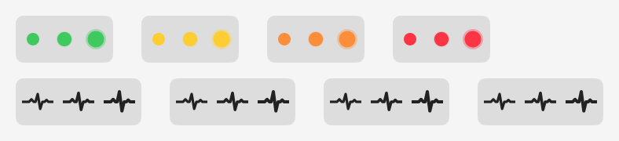
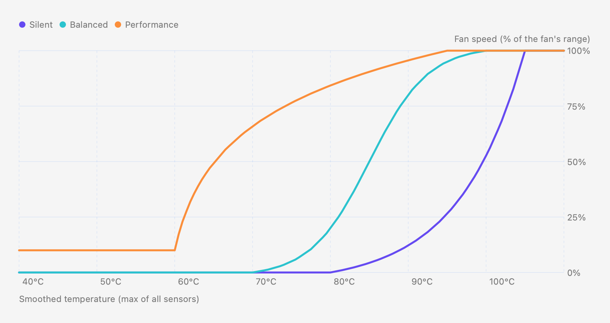
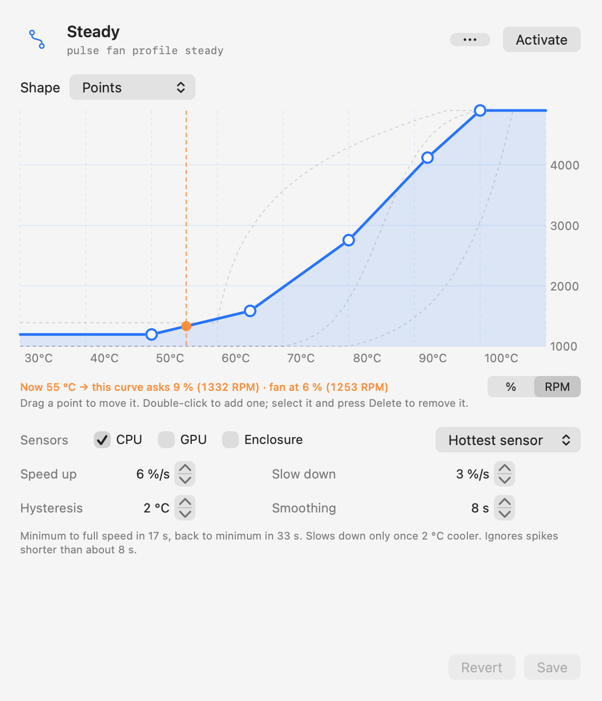

<p align="center">
  
</p>

# Pulse

**Temperatures and fan speed in your Mac's menu bar, with full control over the fans.**

Pulse is a lightweight, native Swift app for Apple silicon Macs. It shows your Mac's temperatures and fan speed in the menu bar, and lets you pick a fan profile or design your own curve. A `pulse` command does the same from Terminal or over SSH.

<p align="center">
  <picture>
    <source media="(prefers-color-scheme: dark)" srcset="assets/img/menubar-stacked-dark.png">
    
  </picture>
  &nbsp;
  <picture>
    <source media="(prefers-color-scheme: dark)" srcset="assets/img/menubar-heartbeat-dark.png">
    
  </picture>
  &nbsp;
  <picture>
    <source media="(prefers-color-scheme: dark)" srcset="assets/img/menubar-pulse-dark.png">
    
  </picture>
</p>

> 🚧 **Work in progress, close to 1.0.** Tested on a Mac mini M4 and a 14" MacBook Pro M1 Pro (macOS 27). A hardware test campaign and the 1.0 release are next. See the [roadmap](docs/ROADMAP.md).

## What works today

| | |
|---|---|
| **Menu bar** | A **pulse dot** coloured by temperature (green → yellow → orange → red) that **beats like a heart**, faster as the Mac heats up (40 to 120 bpm), or a **monochrome** dot that blends in with the other menu bar icons. Alternatives are a heartbeat trace, a fan, or no icon. Readings are optional: CPU and GPU temperature, fan speed (RPM or %), and power draw, **stacked** on two small lines or inline. Values are smoothed over ~8 s and centred on cap height, with fixed widths so nothing shifts. |
| **Popover** | Average and hottest sensor per group (CPU, GPU, board), fan speed and curve target, a 5-minute history, and one-click profiles. Warnings appear when the fan service is missing, the safety guard has engaged, or another fan app is running. |
| **Profiles** | *Auto* (macOS), *Silent*, *Balanced*, *Performance*, and your own curves. |
| **Custom curves** | Percent-based shapes (linear, sigmoid, exponential, logarithmic, steps) that you stretch with start/end temperatures, a floor, a ceiling and a steepness. You can also use explicit points. |
| **Curve editor** | In Settings › Curves: drag the ramp's ends or free points on a chart, pick a shape and its steepness, choose sensors and how fast the fan may speed up or slow down. A live marker shows the current temperature and what the curve would ask for, with the presets drawn faintly for reference. Undo, % or RPM axis, and unsaved changes are never lost silently. |
| **Automation** | In Settings › Automation, rules switch the profile on their own: *Performance* while a game or app is open, *Silent* in Low Power Mode, on battery or on the power adapter. The first rule that applies wins; a profile you pick by hand always wins until the rule's condition goes away. |
| **Sensor refresh** | In Settings › General › Sensors, a slider sets how often the sensors are read, from 1 to 5 s (2 s by default). On a MacBook, an optional slower pace applies on battery; the service switches the moment you unplug, even with Pulse closed. |
| **Every Apple silicon Mac** | Two-fan MacBook Pros run each fan on its own range from the same curve. Fanless MacBook Airs get temperatures only: no fan readings, no profiles. |
| **Help** | Settings › Help explains what each setting does to the fans, and what to do when something looks wrong. |
| **`pulse` CLI** | `pulse status` gives an overview for SSH. `pulse fan curve …` creates, previews, edits and deletes curves. Every command supports `--json`. |
| **Footprint** | The app uses ~0.1% CPU and ~20 MB at idle (closed windows release their views; the beating icon costs ~2–4% while it beats). With a curve active, the daemon uses ~0.3% CPU at the default 2 s pace (0.14% at 5 s); on *Auto* it reads the sensors only when the app asks. It skips redundant fan writes and caches SMC key metadata. |

### The heartbeat

<p align="center">
  <picture>
    <source media="(prefers-color-scheme: dark)" srcset="assets/img/menubar-beats-dark.png">
    
  </picture>
</p>

By default the icon beats **only when the Mac is warm** (CPU above 65 °C). At rest it stays still and costs nothing. Every beat redraws the menu bar item, which macOS 26 repeats for each display and appearance. *Always* therefore costs about 2–3% CPU, while *When warm* costs nothing until the Mac is working hard anyway. The heartbeat stops while the screens sleep, in Low Power Mode, with Reduce Motion, and when the safety guard engages.

## Profiles and curves

Every curve maps a **smoothed** temperature to a fan speed in **percent of the fan's own range**. 0% is the fan's minimum RPM and 100% its maximum. The same curve therefore behaves the same on a Mac mini and on a MacBook with two fans.

What happens **at 0%** (below the ramp, when the curve's floor is 0%) is chosen per curve, in the editor (*At 0 %*) or with `--at-zero`:

| | |
|---|---|
| **macOS decides** (default) | After 15 s at 0%, Pulse hands the fan back to macOS. A cool MacBook stops its fans, as it does without Pulse; its reported minimum (1200 RPM on a 14" MacBook Pro) is only the slowest *spinning* speed. A Mac mini idles at its minimum. macOS may also spin the fan faster than the curve's floor. |
| **Minimum speed** | The fan holds its minimum RPM: predictable, never faster than the curve, never stopped. |
| **Stopped** (experimental) | After 15 s at 0%, Pulse stops the fan, even on a Mac mini. It restarts it at its minimum as soon as a CPU or GPU sensor passes 75 °C or any other sensor 50 °C, whatever the curve watches, and stops it again only 5 °C below. |

> [!WARNING]
> **Stopping a fan may harm your Mac.** You force the hardware into a state its firmware does not choose on its own: macOS never stops a Mac mini's fan, and parts without a temperature sensor may heat up without airflow. It is off unless you also opt in as root, under `[safety]` in `/etc/pulse/config.toml`:
>
> ```toml
> [safety]
> allow_below_minimum = true
> ```
>
> then `sudo pulse daemon restart`. Without it, *Stopped* behaves like *macOS decides*. The thermal safety guard (100 °C) stays active in every mode.

The 15 s delay keeps a temperature hovering at the ramp start from toggling the fan. As soon as the curve rises above 0%, Pulse takes the fan again. A curve with a floor above 0%, like *Performance* (10%), keeps the fans spinning.

<p align="center">
  <picture>
    <source media="(prefers-color-scheme: dark)" srcset="assets/img/curves-dark.png">
    
  </picture>
</p>

| Preset | Shape | Ramp | Speed | Smoothing | Hysteresis | Rise / fall |
|---|---|---|---|---|---|---|
| **Silent** | exponential (steepness 3): stays low, then accelerates | 80 → 105 °C | 0 → 100% | 10 s | 3 °C | 5 / 2 %/s |
| **Balanced** | sigmoid (steepness 8): calm, then a decisive climb | 70 → 100 °C | 0 → 100% | 6 s | 3 °C | 8 / 3 %/s |
| **Performance** | linear, on the **CPU average** (not the hottest sensor): steady and predictable | 55 → 90 °C | 10 → 100% | 5 s | 2 °C | 10 / 4 %/s |

Each curve runs through the same pipeline once per second:

1. Take the **max** of all temperature sensors, or of the curve's sensors. Sensors of powered-down blocks are ignored: an idle GPU reads ~0 °C.
2. **Smooth** it with an exponential moving average, so a one-second spike does not rev the fan.
3. Apply **hysteresis**: the temperature has to drop a few degrees before the fan slows down.
4. Read the speed off the curve.
5. Limit how fast the speed changes. Rising is faster than falling, so the fan ramps up quickly and winds down gently.

The presets are calibrated for Apple silicon hot-spot sensors. These idle around 55–65 °C and reach 95–105 °C under sustained load. Apple's own policy on the Mac mini M4 keeps the fan near its minimum until ~100 °C.

### Your own curves

Duplicate a preset (or click **+**) in **Settings › Curves**, then shape it on the chart:

<p align="center">
  <picture>
    <source media="(prefers-color-scheme: dark)" srcset="assets/img/editor-dark.png">
    
  </picture>
</p>

Or from the command line, the same curves:

```console
$ pulse fan curve set night --shape sigmoid --start 75 --end 100 --max 60% --activate
$ pulse fan curve set work --from balanced --start 65          # copy a preset and tweak it
$ pulse fan curve set custom --points 60:10%,80:45%,95:max --sensors 'Tp*'
$ pulse fan curve show night                                   # table and bars: °C → % → RPM
$ pulse fan curve set night --end 95 --dry-run                 # preview without saving
```

Curves live in `/etc/pulse/config.toml`. The file is readable and versionable, and you can also edit it by hand:

```toml
[fan]
profile = "night"
interval = 2            # seconds between sensor reads, 1 to 5 (Settings › General › Sensors)
battery_interval = 4    # optional: slower pace on battery

[[fan.curves]]
name = "night"
label = "Night"
sensors = ["Tp*"]
shape = { type = "sigmoid", start = 75.0, end = 100.0, min = "0%", max = "60%", steepness = 8.0 }
hysteresis = 3.0
slew_rate = "6%"
fall_slew_rate = "2%"
smoothing = 10.0
idle = "minimum"        # at 0%: "system" (default), "minimum" or "off"
```

## Command line

```console
$ pulse status
pulse · daemon 0.2.4 · profile balanced · every 2 s

Temperatures
  CPU     avg 55.5 °C  max 75.0 °C  (Tp3P) · 12 sensors
  GPU     avg 40.1 °C  max 41.6 °C  (Tg0D) · 4 sensors
  Board   avg 37.3 °C  max 44.3 °C  (Ts0M) · 13 sensors

Fans
  Fan 0   1341 RPM  9% · target 1340 RPM · manual · range 1000–4900

Curve
  Fan 0   75.0 °C in → 58.4 °C effective → 1340 RPM

Safety  ok · ceiling 100.0 °C (hot-spots 110.0 °C)
```

| Command | What it does |
|---|---|
| `pulse status [--watch] [--json]` | Overview: temperatures, fans, profile, curve, power, safety, other fan controllers |
| `pulse doctor [--test-fans] [--json]` | Diagnostic report for bug reports: model, chip, fans and their unlock path (direct or Ftst), charging control, sensors, daemon, conflicts. `--test-fans` drives each fan to 40 % for a few seconds and restores the profile |
| `pulse fan interval [1-5] [--on-battery]` | Show or set how often the daemon reads the sensors (default 2 s), optionally a slower pace on battery (`same` removes it). Shorter reacts faster, longer uses less energy; near the safety ceiling it reads every second anyway |
| `pulse fan profile auto\|silent\|balanced\|performance\|<curve>` | Switch profile |
| `pulse fan curve list\|show\|set\|delete` | Manage curves |
| `pulse fan set <rpm>` / `pulse fan auto` | Manual target / back to macOS |
| `pulse sensors`, `pulse power status` | Raw sensors, thermal pressure and power |
| `pulse battery …`, `pulse display …`, `pulse alert …` | Inherited from smctl (see [docs/smctl-README.md](docs/smctl-README.md)) |
| `pulse daemon install\|uninstall\|status\|logs` | Manage the privileged service |

## Install (from source)

Requires Xcode 26 or later and an Apple silicon Mac. The Command Line Tools alone are not enough: SwiftUI's macros (`@State`, …) ship only with Xcode. If `xcode-select -p` prints `/Library/Developer/CommandLineTools`, `build-app.sh` uses Xcode for the build anyway. To make Xcode the default:

```console
$ sudo xcode-select -s /Applications/Xcode.app/Contents/Developer
```

```console
$ git clone https://github.com/fstormacq/pulse && cd pulse
$ scripts/build-app.sh                 # builds dist/Pulse.app with pulse and pulsed inside
$ open dist/Pulse.app
```

Open the menu bar item, click **Install…**, and enter your administrator password. This installs the fan control service. **Settings → Service** can also put the `pulse` command in `/usr/local/bin`.

CLI only:

```console
$ swift build -c release
$ sudo .build/release/pulse daemon install
```

The build is ad-hoc signed for personal use. Writes to the fan service are allowed for administrator accounts.

## Safety

Fan writes happen in one small root daemon (`pulsed`). The app and the CLI are unprivileged clients over XPC. From smctl, Pulse inherits:

- **Never leave a brick.** Quitting, killing, uninstalling or crashing hands the fans back to macOS: termination hooks, startup reconciliation and launchd restart.
- **Thermal safety guard.** It cannot be disabled. A sustained reading above 100 °C (hot-spots 110 °C) returns the fans to macOS until things cool down. Losing every sensor also trips it. Pulse reads the sensors every second near the limit, whatever the refresh setting, and notifies you when the guard engages and when it releases.
- **Verified writes and graceful degradation.** If a macOS update changes the SMC, fan control turns read-only and says so.

Pulse adds input validation for curves, refuses to rewrite a config file that fails to parse, ignores powered-down sensors, and warns when another fan app (TG Pro, Macs Fan Control, Stats, smcFanControl, smctl) is installed or running.

## Architecture

```
Pulse.app (SwiftUI + AppKit status item) ─┐
pulse CLI ────────────────────────────────┼─ XPC ─▶ pulsed (root LaunchDaemon) ─▶ AppleSMC
                                          │          ├─ PolicyEngine: curves, shapes, smoothing, safety
                                          │          └─ /etc/pulse/config.toml
```

- `Sources/`: the core package (smctl plus Pulse additions in separate files).
- `App/`: the menu bar app (separate SwiftPM package; open `App/Package.swift` in Xcode).
- `swift test` in the root and in `App/` runs ~280 tests. `swift run --package-path App PulseSnapshots <dir>` renders the UI with sample data.
- `swift run -c release --package-path App PulseBench` measures CPU and memory with the real status item, popover, settings and editor (and checks that closed windows release their views). `swift run --package-path App PulseLiveCheck <path to pulse>` runs the editor's save path against the installed daemon and cleans up after itself.

## Built on smctl

Pulse is a fork of [**smctl**](https://github.com/leaperone/smctl) by harryisfish and contributors (MIT). smctl provides the SMC layer, the privileged daemon, the fan curve engine and its safety mechanisms, plus battery, power and display control. Pulse keeps all of it and regularly merges upstream changes. Product names live in one file, `Sources/ProductIdentity`, so merges stay simple.

## License

[MIT](LICENSE). © 2026 Florian Stormacq, and © 2026 harryisfish and the smctl contributors.
