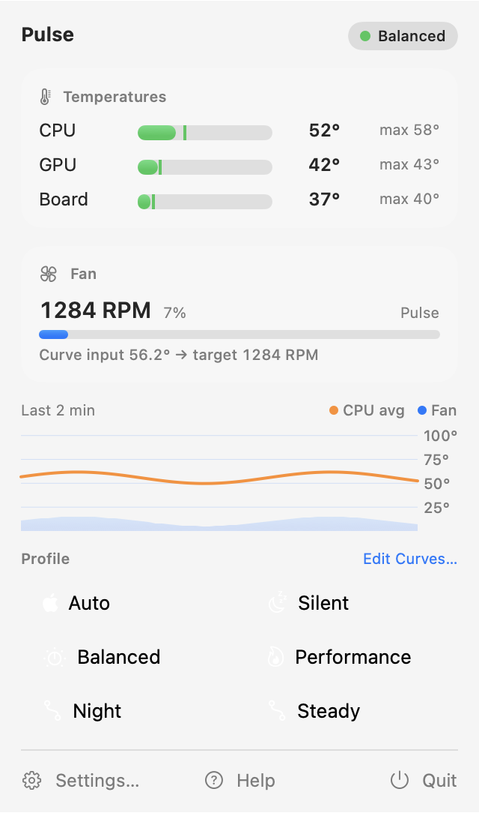
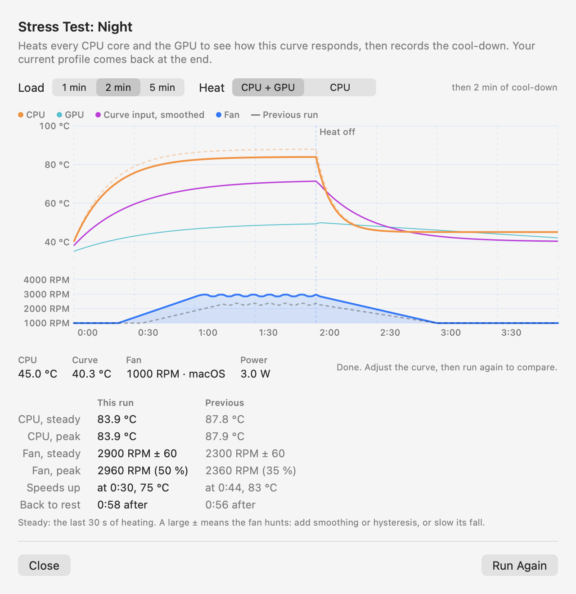

<p align="center">
  
</p>

# Pulse

**Your Mac's temperatures in the menu bar, and the fans under your control.**

Pulse is a small native app for Apple silicon Macs. It shows how hot your Mac runs and how fast its fans spin, and lets you decide how the fans react: quieter, cooler, or exactly to your own curve. A `pulse` command does the same from Terminal or over SSH.

<p align="center">
  <picture>
    <source media="(prefers-color-scheme: dark)" srcset="assets/img/popover-dark.png">
    
  </picture>
</p>

- **See** CPU, GPU and fan speed at a glance in the menu bar, with a dot that beats faster as your Mac heats up.
- **Choose** how the fans behave with one click: *Silent*, *Balanced*, *Performance*, or *Auto* to leave it to macOS.
- **Shape** your own fan curve on a chart, then check it with a built-in stress test.
- **Automate** it: *Performance* while a game is open, *Silent* on battery.
- **Stay safe**: Pulse always hands the fans back to macOS if anything goes wrong, and you can't turn that off.

Free and open source (MIT). Tested on a Mac mini M4 and a MacBook Pro M1 Pro.

## Install

You need an **Apple silicon Mac** (M1 or later) with **macOS 26** or later for the app.

```console
$ brew tap fstormacq/tap && brew trust fstormacq/tap
$ brew install --cask fstormacq/tap/pulse
```

Use the full name `fstormacq/tap/pulse`: Homebrew already has an unrelated app called `pulse`, which a plain `brew install --cask pulse` would install instead.

No Homebrew? Download `Pulse-<version>.zip` from the [latest release](https://github.com/fstormacq/pulse/releases/latest) and drag Pulse to Applications. Pulse isn't notarized by Apple, so the first time macOS refuses to open it: go to **System Settings › Privacy & Security** and click **Open Anyway**. With Homebrew, there is nothing to do.

### First launch

1. **Open Pulse** from Applications. It lives in the menu bar, not in the Dock.
2. **Click the Pulse icon**, then **Install…**, and enter your password. This installs the small service that drives the fans. Until then, Pulse only shows temperatures.
3. **Pick a profile.** *Balanced* is a good start.

To have Pulse start with your Mac, turn on **Open Pulse at login** in Settings › General.

### Command line only

For a Mac you reach over SSH, or if you prefer Terminal (macOS 14 or later):

```console
$ brew tap fstormacq/tap && brew trust fstormacq/tap
$ brew install fstormacq/tap/pulse-cli
$ sudo pulse daemon install
```

The app already includes the `pulse` command, so install one or the other.

## Using Pulse

### The menu bar

The dot is coloured by temperature (green → yellow → orange → red) and beats like a heart when the Mac is warm, faster as it heats up. Next to it, the readings you choose: CPU and GPU temperature, fan speed, power draw.

<p align="center">
  <picture>
    <source media="(prefers-color-scheme: dark)" srcset="assets/img/menubar-stacked-dark.png">
    
  </picture>
  &nbsp;
  <picture>
    <source media="(prefers-color-scheme: dark)" srcset="assets/img/menubar-heartbeat-dark.png">
    
  </picture>
  &nbsp;
  <picture>
    <source media="(prefers-color-scheme: dark)" srcset="assets/img/menubar-pulse-dark.png">
    
  </picture>
</p>

Click it for the details: average and hottest sensor per group, fan speed and what the curve asks for, the last few minutes, and the profiles. **Settings › General** changes the icon (pulse dot, heartbeat, fan, or none, in colour or monochrome) and the readings.

### Profiles

| Profile | What it does |
|---|---|
| **Auto** | macOS drives the fans, as if Pulse weren't there. |
| **Silent** | Stays quiet until the chip gets really hot (from 80 °C), then catches up quickly. |
| **Balanced** | Calm at light load, then a decisive climb between 70 and 100 °C. |
| **Performance** | Fans always spinning, rising steadily from 55 °C: cooler under sustained load. |

<p align="center">
  <picture>
    <source media="(prefers-color-scheme: dark)" srcset="assets/img/curves-dark.png">
    
  </picture>
</p>

Apple silicon chips run hot by design: hot spots idle around 55–65 °C and reach 95–105 °C under load. That is normal.

### Your own curves

In **Settings › Curves**, duplicate a profile (or click **+**) and shape it on the chart: drag the ends of the ramp or free points, pick a shape, choose which sensors it watches and how fast the fans may speed up or slow down. A live marker shows the current temperature and the speed the curve would ask for.

<p align="center">
  <picture>
    <source media="(prefers-color-scheme: dark)" srcset="assets/img/editor-dark.png">
    
  </picture>
</p>

Curves are in percent of each fan's own range, so one curve behaves the same on a Mac mini and on a MacBook Pro with two fans.

### Check a curve with a stress test

**Stress Test…** next to a curve heats every CPU core and the GPU for 1 to 5 minutes, records how the fans respond and how the Mac cools down, and puts the result next to the previous run. Tweak the curve, run it again, compare.

<p align="center">
  <picture>
    <source media="(prefers-color-scheme: dark)" srcset="assets/img/stress-test-dark.png">
    
  </picture>
</p>

### Automation

In **Settings › Automation**, rules switch the profile for you: while an app or game is open, in Low Power Mode, on battery, or on the power adapter. The first matching rule wins, and a profile you pick by hand wins until the rule's condition goes away.

### From Terminal or over SSH

```console
$ pulse status
pulse · daemon 1.0.0 · profile balanced · every 2 s

Temperatures
  CPU     avg 55.5 °C  max 75.0 °C  (Tp3P) · 12 sensors
  GPU     avg 40.1 °C  max 41.6 °C  (Tg0D) · 4 sensors
  Board   avg 37.3 °C  max 44.3 °C  (Ts0M) · 13 sensors

Fans
  Fan 0   1341 RPM  9% · target 1340 RPM · manual · range 1000–4900

Safety  ok · ceiling 100.0 °C (hot-spots 110.0 °C)

$ pulse fan profile silent                    # switch profile
$ pulse fan curve set night --from balanced --start 75 --max 60% --activate
$ pulse fan stress balanced night             # heat the Mac under each, compare
```

Every command accepts `--json`. The [full list](#command-reference) is below.

## Updates

Pulse tells you when a new version is out, in the popover and in `pulse`. To update:

```console
$ brew upgrade --cask fstormacq/tap/pulse        # or: brew upgrade fstormacq/tap/pulse-cli
```

The fan service updates itself: the next time Pulse starts, it asks for your password once and installs its new version. Your profiles and curves are kept. With the command line only, the next `pulse` command does the same through `sudo`.

## How Pulse keeps your Mac safe

- **A temperature guard you can't turn off.** If a sensor stays above 100 °C (110 °C for the chip's hot spots), or if no sensor can be read, Pulse hands the fans back to macOS and notifies you. Near the limit it reads the sensors every second.
- **Nothing gets stuck.** Quitting Pulse, a crash or uninstalling all return the fans to macOS.
- **One small privileged service.** Only `pulsed` writes to the hardware. The app and the `pulse` command ask it over XPC, and it checks every request.
- **It degrades gracefully.** If a macOS update changes the hardware interface, fan control turns read-only and says so.
- **It warns about other fan apps** (TG Pro, Macs Fan Control, Stats, …), which would fight over the fans.

## Uninstall

```console
$ sudo pulse daemon uninstall      # stops the service and hands the fans back to macOS
$ brew uninstall --cask fstormacq/tap/pulse      # or: brew uninstall fstormacq/tap/pulse-cli
```

Without Homebrew: **Settings › Service › Uninstall…**, then drag Pulse to the Trash.

## Help

- **[docs/HELP.md](docs/HELP.md)** explains every setting and what to do when something looks wrong. **Help** in the popover opens it.
- **Something wrong?** Run `pulse doctor` and paste the output in an [issue](https://github.com/fstormacq/pulse/issues). `pulse doctor --test-fans` also checks that each fan obeys.
- **MacBooks with an M3 or M4** use a fan unlock path not yet tested on real hardware. A `pulse doctor --test-fans` report from one is very welcome.

## Going further

<details>
<summary><b>How a curve turns temperature into fan speed</b></summary>

At every sensor read (every 2 s by default, 1 to 5 s in Settings › General › Sensors, optionally slower on battery):

1. Take the **hottest** of the curve's sensors (all of them by default). Sensors of powered-down parts are ignored: an idle GPU reads ~0 °C.
2. **Smooth** it, so a one-second spike does not rev the fan.
3. Apply **hysteresis**: the temperature has to drop a few degrees before the fan slows down.
4. Read the speed off the curve, in percent: 0 % is the fan's minimum RPM, 100 % its maximum.
5. Limit how fast the speed changes. Rising is faster than falling: the fan ramps up quickly and winds down gently.

| Preset | Shape | Ramp | Speed | Smoothing | Hysteresis | Rise / fall |
|---|---|---|---|---|---|---|
| **Silent** | exponential (steepness 3) | 80 → 105 °C | 0 → 100 % | 10 s | 3 °C | 5 / 2 %/s |
| **Balanced** | sigmoid (steepness 8) | 70 → 100 °C | 0 → 100 % | 6 s | 3 °C | 3 / 1 %/s |
| **Performance** | linear, on the CPU average | 55 → 90 °C | 10 → 100 % | 5 s | 2 °C | 10 / 4 %/s |

</details>

<details>
<summary><b>What happens at 0 %</b></summary>

Below the ramp, a curve with a 0 % floor can do one of three things, chosen per curve (*At 0 %* in the editor, `--at-zero` in the CLI):

| | |
|---|---|
| **macOS decides** (default) | After 15 s at 0 %, Pulse hands the fan back to macOS. A cool MacBook stops its fans, as it does without Pulse; a Mac mini idles at its minimum. |
| **Minimum speed** | The fan holds its minimum: predictable, never stopped. |
| **Stopped** (experimental) | After 15 s at 0 %, Pulse stops the fan, even on a Mac mini, and restarts it as soon as a CPU or GPU sensor passes 75 °C or any other sensor 50 °C. |

> [!WARNING]
> **Stopping a fan may harm your Mac.** macOS never stops a Mac mini's fan, and parts without a temperature sensor may heat up without airflow. *Stopped* stays off unless you also opt in as root, in `/etc/pulse/config.toml`:
>
> ```toml
> [safety]
> allow_below_minimum = true
> ```
>
> then `sudo pulse daemon restart`. The temperature guard stays active in every mode.

</details>

<details>
<summary><b>The configuration file</b></summary>

Everything lives in `/etc/pulse/config.toml`: readable, versionable, editable by hand or over SSH. The app and the CLI write the same file through the service.

```toml
[fan]
profile = "night"
interval = 2            # seconds between sensor reads, 1 to 5
battery_interval = 4    # optional: slower pace on battery

[[fan.curves]]
name = "night"
label = "Night"
sensors = ["Tp*"]       # CPU hot spots; "Tg*" GPU, "Ts*" board
shape = { type = "sigmoid", start = 75.0, end = 100.0, min = "0%", max = "60%", steepness = 8.0 }
hysteresis = 3.0
slew_rate = "6%"        # per second, rising
fall_slew_rate = "2%"   # per second, falling
smoothing = 10.0
idle = "minimum"        # at 0 %: "system" (default), "minimum" or "off"

[update]
check = true            # daily check for new releases on GitHub
```

</details>

<details>
<summary><b>The heartbeat and Pulse's footprint</b></summary>

<p align="center">
  <picture>
    <source media="(prefers-color-scheme: dark)" srcset="assets/img/menubar-beats-dark.png">
    
  </picture>
</p>

By default the icon beats only when the Mac is warm (CPU above 65 °C), from 40 to 120 beats per minute. At rest it stays still and costs nothing. *Always* costs about 2–3 % CPU, because macOS redraws the menu bar item for every display. The heartbeat stops while the screens sleep, in Low Power Mode, with Reduce Motion, and when the temperature guard engages.

At rest, the app uses about 0.1 % CPU and 20 MB. With a curve active, the service uses about 0.3 % CPU at the default 2 s pace (0.14 % at 5 s). On *Auto*, it reads the sensors only when the app asks.

</details>

### Command reference

| Command | What it does |
|---|---|
| `pulse status [--watch]` | Temperatures, fans, profile, curve, power, safety, other fan apps |
| `pulse fan profile auto\|silent\|balanced\|performance\|<curve>` | Switch profile |
| `pulse fan curve list\|show\|set\|delete` | Manage curves (`set --dry-run` previews) |
| `pulse fan stress <profile>… [--load s] [--cool s] [--cpu-only] [--csv file]` | Stress test one or more profiles and compare them |
| `pulse fan interval [1-5] [--on-battery]` | How often the sensors are read |
| `pulse fan set <rpm>` / `pulse fan auto` | Fixed speed / back to macOS |
| `pulse doctor [--test-fans]` | Diagnostic report for bug reports |
| `pulse sensors`, `pulse power status` | Raw sensors, thermal pressure and power |
| `pulse daemon install\|uninstall\|restart\|status\|logs` | Manage the fan service |
| `pulse battery …`, `pulse display …`, `pulse alert …` | Inherited from smctl ([docs](docs/smctl-README.md)) |

All commands accept `--json`.

## For developers

Contributions are welcome. [CONTRIBUTING.md](CONTRIBUTING.md) explains the workflow: a branch per change, a pull request into `dev` titled like a commit, and releases from `dev` into `main`. [docs/ARCHITECTURE.md](docs/ARCHITECTURE.md) explains where the code of each part lives, why, and how to make common changes.

<details>
<summary><b>Build from source</b></summary>

Requires Xcode 26 or later (the Command Line Tools alone lack SwiftUI's macros).

```console
$ git clone https://github.com/fstormacq/pulse && cd pulse
$ make app                     # dist/Pulse.app, with pulse and pulsed inside
$ open dist/Pulse.app
$ make test                    # both packages
$ make help                    # every target
```

Command line only: `swift build -c release && sudo .build/release/pulse daemon install`. A build from source is version `0.0.0-dev`: it never offers updates and never replaces a released service.

</details>

<details>
<summary><b>Architecture at a glance</b></summary>

```
Pulse.app (SwiftUI + AppKit status item) ─┐
pulse CLI ────────────────────────────────┼─ XPC ─▶ pulsed (root LaunchDaemon) ─▶ AppleSMC
                                          │          ├─ PolicyEngine: curves, shapes, smoothing, safety
                                          │          └─ /etc/pulse/config.toml
```

- `Sources/`: the core package (smctl, plus Pulse's additions in separate files): SMC access, policy engine, daemon, XPC protocol and client, CLI.
- `App/`: the menu bar app, a separate SwiftPM package (open `App/Package.swift` in Xcode).
- Details, tests and tools: [docs/ARCHITECTURE.md](docs/ARCHITECTURE.md). Design notes and history: [docs/ROADMAP.md](docs/ROADMAP.md) and [docs/PLAN.md](docs/PLAN.md) (in French).

</details>

## Built on smctl

Pulse is a fork of [**smctl**](https://github.com/leaperone/smctl) by harryisfish and contributors (MIT). smctl provides the hardware layer, the privileged service, the fan curve engine and its safety mechanisms, plus battery, power and display control. Pulse keeps all of it and merges upstream changes regularly.

## License

[MIT](LICENSE). © 2026 Florian Stormacq, and © 2026 harryisfish and the smctl contributors.
